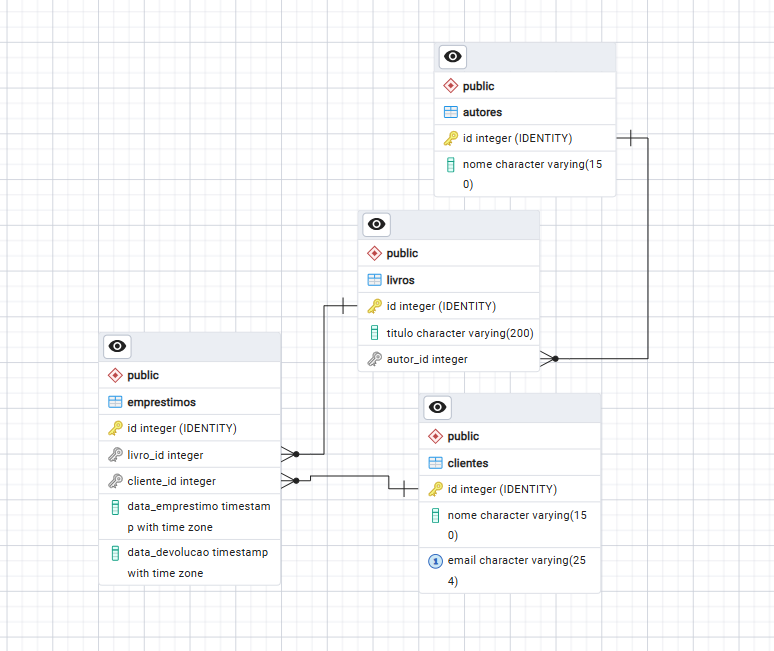

# BookStore Manager CLI

Projeto individual desenvolvido no curso de Desenvolvimento Back-End com Node.js do SCtec.

Aplicação de terminal para gerenciar autores, livros, clientes, empréstimos e devoluções, utilizando TypeScript e uma arquitetura organizada em camadas.

## Tecnologias

- Node.js
- TypeScript
- tsx
- Git e GitHub
- PostgreSQL e pgAdmin para a etapa SQL

## Como executar

Pré-requisitos: Node.js e npm instalados.

Após baixar ou clonar o repositório, abra o terminal na pasta do projeto e instale as dependências:

```bash
npm install
```

Execute em modo de desenvolvimento:

```bash
npm run dev
```

Para compilar e executar o JavaScript gerado:

```bash
npm run build
npm start
```

No Windows, caso o PowerShell bloqueie os comandos do npm, utilize `npm.cmd` no lugar de `npm`.

## Funcionalidades

- Autores: cadastrar, listar, consultar por ID, atualizar e remover.
- Livros: cadastrar, listar, consultar por ID, atualizar e remover.
- Clientes: cadastrar, listar, consultar por ID, atualizar e remover.
- Empréstimos: realizar, consultar por ID, listar todos e listar ativos.
- Devoluções: registrar a devolução de um empréstimo ativo.
- Tratamento de erros com mensagens no terminal.

## Regras de negócio

- Nomes e títulos não podem ficar vazios.
- IDs devem ser números inteiros positivos e seguros.
- O autor precisa existir para cadastrar ou atualizar um livro.
- E-mails são normalizados e não podem se repetir entre clientes.
- Livro e cliente precisam existir para realizar um empréstimo.
- Um livro pode ter apenas um empréstimo ativo por vez.
- Um empréstimo já devolvido não pode ser devolvido novamente.
- Autores com livros cadastrados não podem ser removidos.
- Livros e clientes com histórico de empréstimos não podem ser removidos.

## Armazenamento e dados iniciais

A aplicação utiliza arrays em memória e não se conecta ao PostgreSQL.

Os dados iniciais são carregados pelo arquivo `src/data/seed.ts` a cada execução:

- 2 autores;
- 3 livros;
- 2 clientes;
- 2 empréstimos, sendo um ativo e um devolvido.

As alterações realizadas durante o uso são perdidas ao encerrar a aplicação.

## Arquitetura

| Pasta ou arquivo | Responsabilidade |
| --- | --- |
| `src/models` | Interfaces e classes das entidades |
| `src/repositories` | Armazenamento e manipulação dos arrays |
| `src/services` | Validações e regras de negócio |
| `src/controllers` | Entrada de dados e apresentação dos resultados |
| `src/menus` | Navegação e opções do terminal |
| `src/utils` | Utilitários de interação com o terminal |
| `src/data` | Dados iniciais da aplicação |
| `src/main.ts` | Criação e integração dos componentes |
| `database` | Script SQL e diagrama do banco |

A leitura das respostas no terminal utiliza Promises e `async/await`.

## Exemplo de uso

1. Execute `npm run dev`.
2. Acesse Autores e liste os registros iniciais.
3. Acesse Livros e consulte o livro de ID 2.
4. Acesse Empréstimos e realize um empréstimo do livro 2 para o cliente 1.
5. Liste os empréstimos ativos e anote o ID do novo empréstimo.
6. Registre a devolução utilizando esse ID.

Exemplos de erros tratados:

- Tentar emprestar o livro 1, que já possui um empréstimo ativo nos dados iniciais.
- Cadastrar um cliente com e-mail inválido.
- Tentar remover um livro com histórico de empréstimos.

## Banco de dados SQL

A etapa SQL é independente da aplicação CLI.

O arquivo `database/script.sql` contém:

- Criação das quatro tabelas.
- Chaves primárias e estrangeiras.
- Restrições de integridade.
- Índice único para impedir dois empréstimos ativos do mesmo livro.
- Dados iniciais correspondentes aos da aplicação.
- Exemplos de INSERT, UPDATE e DELETE.
- Consultas com JOINs, agrupamentos, ordenação e contagem.

### Como executar no pgAdmin

1. Crie um banco de dados vazio no PostgreSQL.
2. Selecione esse banco e abra o Query Tool.
3. Abra o arquivo `database/script.sql`.
4. Execute o script completo.
5. Para visualizar cada relatório, selecione e execute sua consulta individualmente.

O script deve ser executado em um banco vazio, pois cria as tabelas e insere os dados iniciais.

### Relatórios

- Livros disponíveis.
- Livros emprestados.
- Quantidade de livros por autor.
- Quantidade de empréstimos por livro.
- Clientes com empréstimos ativos.
- Até cinco livros mais emprestados.

## Diagrama de Entidade-Relacionamento



Relacionamentos:

- Um autor pode ter zero ou vários livros; cada livro pertence a um autor.
- Um livro pode ter zero ou vários empréstimos no histórico; cada empréstimo corresponde a um livro.
- Um cliente pode ter zero ou vários empréstimos; cada empréstimo pertence a um cliente.

## Versionamento

O desenvolvimento foi organizado com as branches `main`, `develop` e branches específicas para funcionalidades e documentação.

## Organização do projeto

Link do quadro Kanban: [Quadro Kanban — BookStore Manager CLI](https://github.com/users/KelwinKlinger/projects/2)

## Vídeo de apresentação

Link do vídeo: a adicionar.

## Autor

Kelwin Klinger.